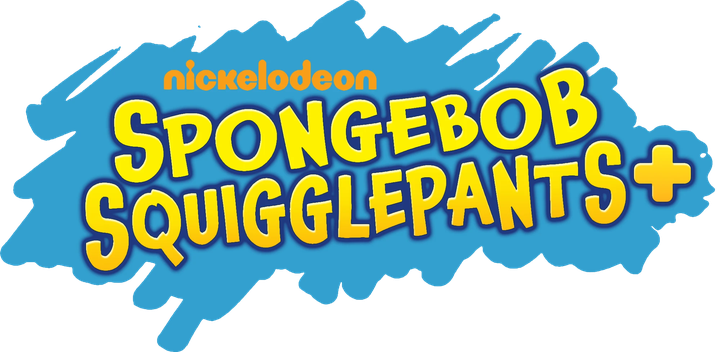
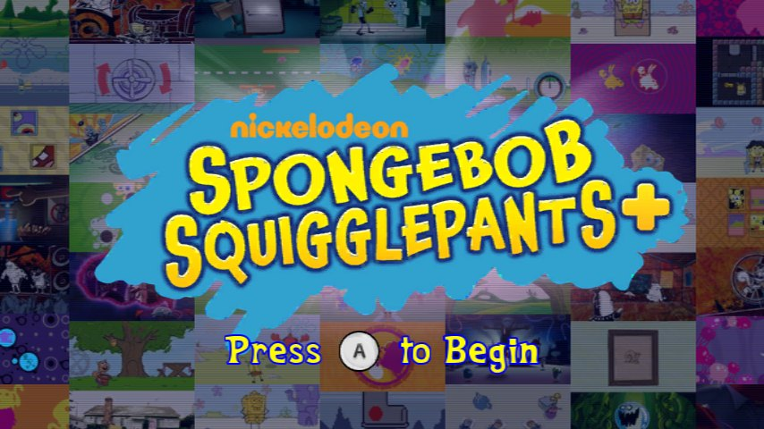
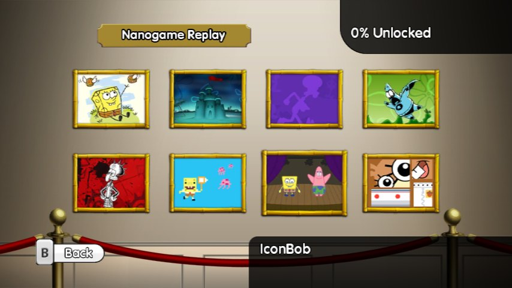
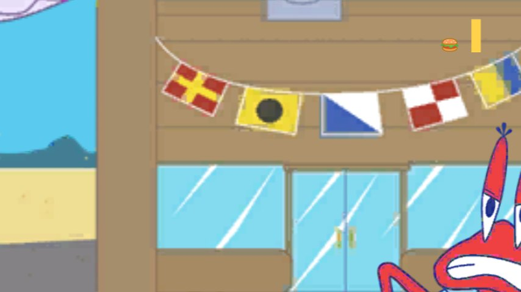
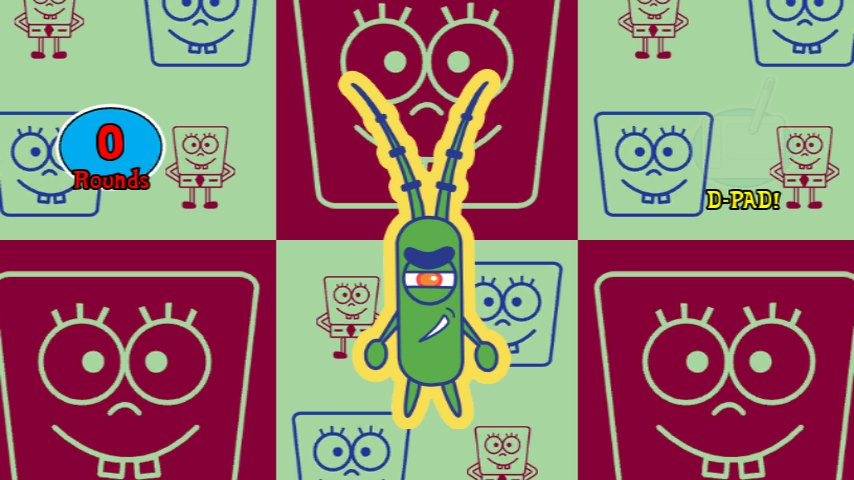
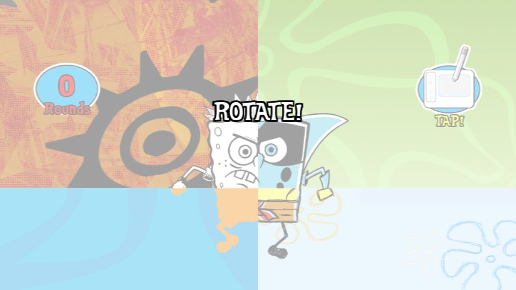

  

  <b>A free, fan-made Riivolution patch for <i>SpongeBob SquigglePants</i> on the Wii (US, <code>SS8E78</code>).</b> 
  Version 1.0 &middot; 22 October 2026 &middot; by Mitch "WubbzP" Bentz

  <a href="downloads/SpongeBob-SquigglePants-plus-v1.0.zip"><b>Download v1.0</b></a> &middot;
  <a href="features/">Features</a> &middot;
  <a href="download/">How to Install</a> &middot;
  <a href="credits/">Credits</a>

---

*SpongeBob SquigglePants+* brings the Wii version of *SpongeBob SquigglePants* closer to the Nintendo 3DS version and fixes what the original left broken: the lost IconBob nanogames, a cut nanogame, the 99% bug, the slow ending credits and a long list of titles and text.

This repository holds the patch's website and the release download. The download contains **no game files**: you make the patched files yourself, once, from your own copy of the game.

  
  

## What's New

Every part is a separate Riivolution option, and all but the Dev Menu are on by default.

| Option | What it does |
| --- | --- |
| **100% Completion Fix** | The save screen's last point needed 101 rounds in a Nanogame Replay game, so a finished save could still show 99%. Now 100 rounds count, as they already did for the game's own 100% rewards. |
| **Ending Credits Slowdown Fix** | The credits after PixelBob's ending (Movies entry 7) drew all of their 6,500 letters every frame. Letters far off the screen are now skipped, so they run at full speed. |
| **Title and Credit Fixes** | Twenty nanogame titles in proper title case, tidied menu text, Luke Brookshier's writer credit from the 3DS version restored, "Developed by WayForward Technologies" out of capitals, Jake Kaufman credited as Composer, and the game's title in italics in every language. |
| **SpongeBob SquigglePants+ Logo** | The high-quality *SpongeBob SquigglePants+* logo on the US title screen, and a "+" on every other language's logo. |
| **IconBob in Replay** | The 3DS world IconBob, whose seven nanogames were left unused on the Wii disc, as the eighth Nanogame Replay section, just before Remix, as on the 3DS. Steer them with the D-Pad (a Nunchuk works too). |
| **Credits and Puzzle de Pants in Options** | A Credits button for the game's full scrolling credits. Watch them to the end and a new frame on the Options wall lets you play "Puzzle de Pants", the nanogame cut from the game. |
| **Dev Menu** *(off by default)* | Starts the game in the developers' own menu, with its controls put back. |

  
  
  

The IconBob nanogames are "Gary Is Going Places", "SpongeBob Says", "Chum Is Fum", "Jellyfish Joy Ride", "Candid Krabs", "To Dive For" and "Bikini Bottom on Ice". Their best scores, medals and "% Unlocked" go in your normal save, which still works without the patch.

## What 100% Needs

All of these, in one save file:

- a gold medal in every Collection and in every Nanogame Replay game;
- the minigames "RetroBob", "Seasons of Sandy" and "Rattle and Roll" at 100, and "Showboating Shower" at 50;
- 75 rounds in Remix;
- 100 rounds in any one Nanogame Replay game (101 without the 100% Completion Fix).

## Installing

You need:

- your own copy of *SpongeBob SquigglePants* for the Wii (US, `SS8E78`) and the uDraw GameTablet;
- a Wii with [Riivolution](https://riivolution.github.io/), or the [Dolphin](https://dolphin-emu.org/) emulator;
- [Python 3](https://www.python.org/downloads/) (on Windows, tick "Add python.exe to PATH" when installing). The first run installs Pillow and NumPy.

Then:

1. Download [`SpongeBob-SquigglePants-plus-v1.0.zip`](downloads/SpongeBob-SquigglePants-plus-v1.0.zip) and unzip it.
2. Copy four files from your game into its `your-game-files` folder: `Boot.vol`, `menus.vol`, `Microgames.vol` and `Game305.vol`. In Dolphin: right-click the game, **Properties**, **Filesystem**, then right-click each file and **Extract File**. (On a Wii, back up your disc with CleanRip first and open the backup in Dolphin.)
3. Run `Make SquigglePants+ Files.bat` (Windows) or `make-files.sh` (macOS or Linux). It checks that the files are the US version's, untouched, and writes the `SquigglePants` folder.
4. Copy the `riivolution` and `SquigglePants` folders to the root of your SD card, or for Dolphin, into its `Load/Riivolution` folder.
5. **Wii:** start Riivolution, pick the game and turn the options on. **Dolphin:** right-click the game, **Start with Riivolution Patches...**, turn the options on and start.

Nothing on your disc or your Wii is changed: the patch only applies while the game is started with it.

## What's in This Repository

| Path | What it is |
| --- | --- |
| `index.html`, `features/`, `download/`, `credits/` | The website's pages. |
| `404.html` | The "page not found" page. It uses paths from the site's root, so it works once the site is at a domain's root. |
| `assets/` | Styles, script, and images taken from the game's files, the patch's builds and screenshots of the patched game. |
| `downloads/` | The release zip: the Riivolution XML, the tools that make the patched files, the patch's source code and its own README. |
| `make_pages.py` | Builds the HTML pages (not needed on the server). |
| `CNAME` | The site's address, `sbsp-plus.wubbzp.com`, for GitHub Pages. |

The site is static and lives at [sbsp-plus.wubbzp.com](https://sbsp-plus.wubbzp.com/), served by GitHub Pages from this repository; it works on any other web host too. Fonts (Nunito) and icons (Font Awesome) load from Google Fonts and cdnjs.

## Credits

- **Patch and website:** Mitch "WubbzP" Bentz
- ***SpongeBob SquigglePants*:** developed by WayForward Technologies and published by THQ, with Nickelodeon. *SpongeBob SquarePants* was created by Stephen Hillenburg.

**Thanks** to the makers of Riivolution and Dolphin, which made the patch possible to build and to test, and to Sandmanfan, Berdstep, Rnjwalkthroughs, Andykishore and KyoakuNaKira.

---

*SpongeBob SquigglePants+* is a fan-made patch, not affiliated with or endorsed by Nickelodeon, THQ, WayForward or uDraw. *SpongeBob SquarePants*, *SpongeBob SquigglePants* and all related titles, logos and characters are trademarks of Viacom International Inc.
